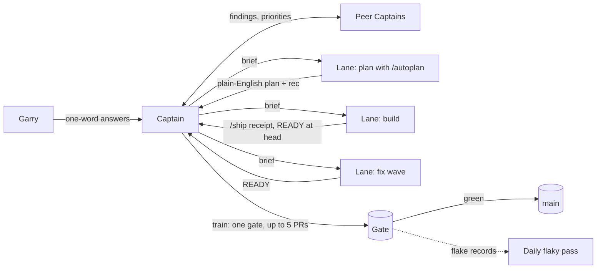

# gstack + Capy: the software factory

gstack is a set of engineering skills: plan reviews, `/ship`, `/review`, `/qa`,
evals. Capy runs agents in the cloud. It gives each thread its own machine, and it
adds Captains that direct a crew of threads, a shared Drive, and automations. Put together, one
person runs a team of agent engineers across several repositories, and the work
lands on main green, reviewed, and in the order he chose.

This page is what we built, how the pieces fit, why we think it is the best way
to run a software factory today, what we learned the hard way, and how Garry
actually uses it. The step-by-step setup is in
[docs/recommended-harness.md](../docs/recommended-harness.md); the controller's
reference is [docs/captain.md](../docs/captain.md).

## The numbers

The 14 days from the 2026-10-15 fix waves (the Captain took over
the next day) against the 14 days before, measured from git and GitHub[^1]:

- **197 PRs merged to gstack's main, up from 65 (3.0x).** That is 98.5 a week.
- **194 versions shipped, 13.9 a day, up from 62 (3.1x).** Nearly every merged PR
  gets its own version number when it merges.
- **Nearly twice gstack's best two weeks before Capy.** The March launch
  shipped 99 versions in its busiest 14 days; these two weeks shipped 194.
- **36 PRs merged and 36 versions shipped in one day** (UTC), on October 25
  and again on October 26.
- **A reported issue is fixed in a median 2.4 days**, from the issue opening to the
  fixing PR's merge, across the 52 issues closed by a PR in the window.
- **1,874 PRs merged across eight of Garry's repositories** in the same 14 days.

What the numbers don't say: PRs got smaller. The median gstack PR fell from
1,292 changed lines to 422, so "3x the PRs" is true and "3x the code" is not.
Small PRs are the point (each one is reviewed, gated and revertible on its
own), but they are not more total output. Time from opening a PR to merging it
went up, from a median of 1.1 hours to 5.6, because trains batch merges.

## What we did

Capy threads started writing gstack PRs on 2026-09-15. On 2026-10-15 Garry
approved two fix waves, and the next day he handed gstack's development
to a Capy Captain, GStack Minder. Its standing job is to keep
`garrytan/gstack` moving and main green. Within two weeks there were seven Captains (gstack, gbrain,
alphaclaw, two eval projects, a game, and a magazine), each directing its own
crew of threads.

Most of what made it work did not exist on day one. It came out of Garry's
replies, one at a time, each turned into a rule and then into gstack itself:

- "yes merge when green" became the Captain's standing merge approval, and then
  [merge trains](../docs/captain.md#merge-trains): one paid gate covers up to
  five READY PRs, and the Captain merges them slot by slot at the exact head.
- "you can just run the failed test again and note that it is flaky and we
  should have a flaky test fix pass every day" became the one-rerun rule and a
  [daily flaky pass](../docs/captain.md#the-daily-flaky-pass) automation.
- "for each plan approval i want a before/after, why it matters, what caused us
  to work on this, and big decisions you had to make" became
  `gstack-owner-brief` and [the three approval shapes](../docs/captain.md#approvals-three-shapes).
- "also we should really be using the gstack ship skill before merging PRs"
  became the `SHIP_RECEIPT` every READY must carry at its head.
- "When you make a new thread or take on new functionality can you remember to
  use gstack autoplan to make a plan for it and then eli5 for approval from me?"
  became [Plan before build](../docs/captain.md#plan-before-build).
- "Gstack should be the actual holder of how to do things not one off Capy
  files" is why all of the above lives in this repository, not in anyone's Drive.

## How Capy and gstack fit together

**Captains, crews and lanes.** A Captain is a long-running Capy thread that owns
one repository's flow. It starts crew threads (lanes), each on its own machine
and branch with named files, so no two lanes edit the same file. The Captain's
Drive holds the crew's contract (`CREW.md`), its digest, and each lane's report;
every rule in it points back at a gstack doc. Lanes never ask Garry directly.
Everything goes through the Captain, which asks in plain words and brings back
his exact reply.

**Plan first, with a plain-language yes.** New functionality starts with
`/autoplan`: a CEO review, an engineering review, design and DX when the work
has them, each with a native and a cross-model voice. The gate goes to Garry as
a short plain-English summary with "rec" as the default answer and a "do it" option that takes
every recommendation at full scope. One "do it" has approved eight plans in a
morning, and the lanes built them in parallel. Reviews catch the expensive
mistakes before code exists. One plan learned that 12 tasks were too few to
prove anything, and another that its adapter needed a translator nobody had planned.

**`/ship` before READY, merge on green.** A lane runs `/ship` at its final
pushed head. That runs the tests, a review sized to the diff, a cross-model
voice where it matters, and writes a receipt bound to that head. The lane sends
one unstamped READY and stops. The Captain batches READY PRs into a train,
reads one full gate, stamps versions at merge, and merges each PR with
`--match-head-commit`, so nothing lands at a head nobody reviewed. A review
finding blocks only when it "would fail a test, break production, or lose data
or secrets" (Garry's floor); the rest goes in the PR body.

**Fix waves.** When main goes red, lanes hold `/ship`, one owner finds the root
cause, and everyone merges main once. Deferred review findings and test-only
follow-ups get folded into one wave PR instead of one PR each. On one crew a
single audit-pin fix cleared a main-wide red and ten PRs landed within the hour.

**The daily flaky pass.** A red test is rerun once at the same tree. A pass is
logged as flaky and the PR moves on; a second red is real. Every morning an
automation starts a lane that fixes the worst repeat offender with a PR that
shows it red before green. Nothing is retried into green and no threshold moves.

**Peer Captains route findings, not chatter.** Captains message each other
with evidence. gstack-evals' replay showed `/review` downgrading real bugs, and
within the hour gstack had a lane on it. Another eval Captain's $5.78 panel found that
OpenClaw refused to load a 78 KB gstack skill, and gstack had a fix up the
same day ([#3610](https://github.com/garrytan/gstack/pull/3610)). When Garry
said "hurry up" to one Captain, another reordered its merge queue for it and
sent back each merge commit.

**Evals with preregistered bars.** A prompt or skill change that claims to
help is judged by a before/after with fixed trials and a bar written down
before the first paid call ([/eval-plan](../docs/skills.md#eval-plan)), never by gut feel.
Good evals here have a no-skill arm and a length-matched placebo, a check that
the treatment actually arrived, decoys verified clean, and spend quoted from
the meter. They report losses as plainly as wins. One preregistered eval found
that with the skill loaded every time, gstack still lost to the placebo on a
cheap model, and that result now drives gstack's work on its review rubric.
In gbrain, a facts block won by 16 points on a held-out set, and only then
did it go on by default.

## Why we think it is the best software factory

- **The owner decides, and only decides.** Garry's job is one-word answers to
  plain-language questions. Everything that a command, a measurement or a test
  can settle gets settled before it reaches him.
- **Main stays green at volume.** Receipts bound to the exact head, merges with
  `--match-head-commit`, trains that test the combination before it lands, and
  a backstop that freezes the queue on a red main.
- **Every rule is code.** The rules live in gstack: bins that refuse a stale
  receipt, tests that cap prompt sizes, a ship policy file. A new crew inherits
  them by installing gstack, not by reading someone's notes.
- **It measures itself.** `gstack-factory-scorecard` reports lead time, gate
  cost, red-train rate and flaky events every week against industry benchmarks (DORA),
  and says `unavailable` instead of 0 when it can't read something.
- **It is honest about cost.** Paid gates are cheap relative to a broken main
  ("it's fine run as many $93 paid gates as you want who cares"), but token
  spend per PR is tracked, capped and treated as a bug when it grows.

## Tips and tricks

1. **Install gstack on every machine, every session.** The first act of every
   thread and subagent is the install check; no `gstack: ok` line means no
   gstack workflow on that machine.
2. **Always offer a "do it".** Garry takes recommendations. Make the
   recommended reply the one-word default, and never offer "the plan as first
   written" as the safe choice.
3. **Ask "worth it?" before three review rounds.** A plan the owner may shelve
   gets a cheap check first. A deploy replay that measured 83 seconds of boot
   cost killed a plan three review rounds had blessed.
4. **Assign versions at merge, not in the PR.** Version and CHANGELOG
   collisions were the second-biggest time sink until READY went unstamped.
5. **Don't merge main every time it moves.** Each merge recreates the
   CHANGELOG conflict and voids the receipt. Merge once, at your slot.
6. **Size review to the diff.** A docs PR doesn't need a red team. Full-depth
   review on small diffs is how `/ship` once cost about 50M tokens per
   PR that needed the full test gate.
7. **Keep threads small.** A long-lived parent context reached 1.36B tokens.
   Hand long steps to fresh children and read the token counter instead of
   estimating.
8. **Use background operations, not watcher subagents**, and message only on a
   decision, a blocker, a READY or a finished phase. Most Captain wakes used to
   be "nothing to report".
9. **Measure before you choose.** Time the queue, count the PRs, run the real
   system. A runner option that looked cheaper in quiet hours failed in a busy
   one.
10. **Severe fixes go first, through the same gates.** In gbrain a
    trust-escalation bug went from report to merged fix in about three hours,
    with its receipt, green checks and merge owner unchanged.

## How Garry uses it

- **He answers in one word, from his phone.** "rec", "do it", "Take all
  recommendations". Long answers mean the ask was badly shaped.
- **He asks for explanations, not jargon.** "Eli5 these recommendations and
  please note in the future you need to explain." Gate codes and slot numbers
  never reach him.
- **He wants to see what changed.** Every merge ask shows before/after images
  of what changed and why.
- **He spends money to save time and tokens to save money.** Paid gates are
  pre-approved; token waste is a P-1 ("Can we get 95% of the outcome but with
  50% of the token use?").
- **He pushes for parallelism.** "Make sure we are parallelizing as much as we
  can that is practical to do": five to eight lanes on disjoint files whenever
  there is a backlog.
- **He turns every annoyance into a rule, and every rule into gstack.** "are you
  learning that the ship review loop is too overzealous?" became the blocking
  floor the same day.
- **He asks the factory to improve itself.** "Ask all captains for feedback on
  how fast or slow things are and if we can maintain quality but go faster",
  then "Can you fix GStack to incorporate the feedback". This page came from
  the same kind of ask.

## Where to go next

- [docs/recommended-harness.md](../docs/recommended-harness.md): set it up, day 0 to the first merged train.
- [docs/captain.md](../docs/captain.md): the controller's reference (READY contract, trains, approvals, digest, flaky pass).
- [capy/skill/gstack/](skill/gstack/): the Capy skill every thread loads, its [factory.md](skill/gstack/factory.md) one-page summary of how crews work, and its [captain.md](skill/gstack/captain.md) for lanes.
- [docs/why-gstack.md](../docs/why-gstack.md): the longer story behind gstack itself.

[^1]: Windows are UTC, [2026-10-01, 2026-10-15) before and
    [2026-10-15, 2026-10-29) after. Merged PRs are GitHub's `mergedAt` with base
    `main` (`gh pr list --state merged --limit 1000 --search 'merged:2026-10-15..2026-10-28 base:main'`
    returns 197; the same query for 10-01..10-14 returns 65). Versions are distinct
    new values of `VERSION` on main's first-parent history. The March comparison is
    the busiest 14-day window between 2026-03-01 and 2026-09-15. Issue-to-fix time
    links issues to PRs through GitHub's closing references and "fixes #n" lines;
    the before window's median (35.9 days) is left out because those PRs were
    clearing an old backlog. The eight-repository total covers gstack, gbrain,
    gbrain-evals and alphaclaw plus four private repositories, which merged 1,243
    of the 1,874 PRs and were created during the window, so it is volume, not a
    speedup. Capy threads were already writing most gstack PRs before the window
    (57 of the 65), so this measures the step to Captains, merge trains and
    `/ship` before READY, not Capy against no agents. Measured 2026-10-29.
