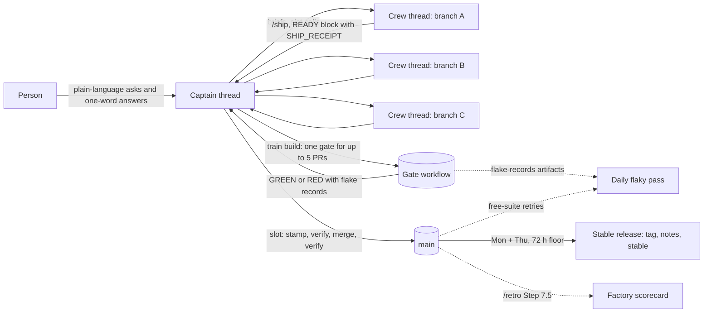

# The recommended harness: gstack + Capy, from zero to the first merged train

This is the operating model a team adopts when it runs gstack under a Capy
Captain: one person, one Captain thread that directs a crew, crew threads that
each own a branch and stop at an unstamped READY, one controller that merges
through trains, a daily flaky pass, a twice-weekly release, and a scorecard that says
whether the factory is getting better. It was written from two crews that ran
it for a week on their own repositories (about 100 merges a week each) and from
the recurring problems four Captains reported while doing so. Every path and
check name below is configurable; nothing here depends on gstack's own
repository.

Two layers, kept apart on purpose:

- **Harness-generic** (works in Claude Code, Codex and any host that reads the
  SKILL.md files): `/ship`, `gstack-ship-queue`, `gstack-restamp`,
  `gstack-pregate`, the ship receipt, the train protocol, the flaky-rerun
  rule, `release-cut`, `gstack-factory-scorecard`, `/retro`.
- **Capy-specific**: the user-scope skill folder and its install check, the
  Captain and its Drive, crew threads, automations, `tools.pr.create`, the
  approvals relay. Each one is marked **Capy** below; the section at the end
  lists what is only Capy.



## Day 0: install

### 1. The user-scope gstack skill (Capy)

Copy `capy/skill/gstack/` from a gstack checkout into the person's user-scope
Drive as `skills/gstack/` (SKILL.md, `captain.md`, `scripts/install.sh`).
Add to the user-scope `AGENTS.md`:

> At the start of each session on a Capy cloud machine, load the user-scoped
> `gstack` skill and perform its installation check before starting work. If
> the check fails, follow the skill's session-start steps. Treat a session with
> no `gstack: ok` line from this machine as having no gstack: run no gstack
> workflow, claim none works, and report any blocker. Repeat this check on each
> separate task machine.

What that buys you: every thread runs `bash scripts/install.sh --check
[--for <skill>]` first and reports exactly one trailer, `gstack: ok <revision>
for=<skill>` or `gstack: fail <ids>`. The install is about 30 seconds cold
and prints the `GSTACK_LAUNCH:` assignments every later command needs
([docs/capy-install.md](capy-install.md)). A thread that runs `/ship` installs
with `--for ship`; a planning-only verdict (`SKIP pins (planning-only)`) does
not admit `/ship`, `/review` or `/qa`.

Two things the first week taught every crew:

- **Most threads never install.** The rule installs right before the first
  workflow, so a thread that does not plan one never gets `/review` or
  `/investigate` either. If most threads in a project run a workflow, bake
  gstack into the project's Capy Setup snapshot instead
  ([capy-install.md#bake-into-a-capy-snapshot](capy-install.md#bake-into-a-capy-snapshot)):
  each session then pays only the check.
- **One revision per thread.** Subagents on fresh machines install
  separately and can land one patch apart. Put the minimum revision your crew
  needs in the crew rules and have every first report quote the trailer, so a
  lane that is behind says so.

### 2. The repository

The harness reads four files from the repository. A team can adopt them one at
a time; each is independent.

| File | Why | Without it |
|---|---|---|
| `.gstack/pregate.json` | Maps changed paths to test lanes, so `/ship` runs the tests that cover the diff and the remote gate selects correctly ([docs/pregate.md](pregate.md)) | `/ship` fails every touched file with `PREGATE_NO_LANE`. Write it once, from one owner, before the crew starts. |
| `.gstack/ship-policy.json` | `queue_mode`, the `train` block (gate and free workflow names, the full-gate check, the train size and fill wait), the stamp files ([docs/ship-policy.md](ship-policy.md)) | Per-PR queue; `train …` refuses with `QUEUE_TRAIN_OFF`. |
| `CHANGELOG.md` + `VERSION` | A stamp per merge and a twice-weekly release with notes ([docs/releases.md](releases.md)) | Skip the version and changelog steps; the train still works on the tree receipt. |
| `AGENTS.md` validation discipline | Diagnose before fixing, focused checks during repair, one full suite at the end on a frozen tree | Threads retry blindly and report passes from older revisions. |

A `.github/workflows` gate that the train can dispatch is the one hard
requirement for trains: a workflow that accepts `workflow_dispatch` with the
train nonce and publishes a check (`full_gate_check`) and a record artifact on
the train head. gstack's own `evals.yml` is the reference; a repository with a
plain test workflow sets `gate_workflow` to it and gets a train without paid
cases.

### 3. The Captain and its Drive (Capy)

Create a Captain from the Capy app (New Captain) or with
`tools.captain.create`. Its Drive is mounted read-write on every crew thread;
this layout is what the crews converged on:

```
captain-<name>/
  AGENTS.md        the Captain's standing rules: mandate, severity bar, standing approvals, every decision quoted verbatim with its date
  CREW.md          the crew rules every thread reads at start (install check, validation discipline, READY shape, stamp-on-call, flaky rule, approvals)
  DIGEST.md        the state of the crew, "Needs you" first; rewritten, never appended
  NOTES.md         the Captain's running log
  skills/          procedures the crew runs: merge-train/, captain-approvals/, and any repo-specific runbook
  reports/<code>.md   one per thread: Outcome, PR (with head SHAs), Needs, Cost, Lesson, Approvals
  handoffs/        datasets and files the next thread needs (the flaky ledger lives here)
  plans/           plans brought for approval
```

The phase-1 templates for these files (`AGENTS.md`, `CREW.md`, `DIGEST.md`, a
report, a READY block, an approvals table, a slot call) ship under
`captain/templates/` with the `/captain` skill, and `docs/captain.md`
explains how the Captain runs a day. Drop the templates in, replace the
placeholders (repository, crew login list, gate workflow name, minimum
revision, who may approve what), and the crew has its rules before its first
thread starts. The approvals shape itself (plan asks with before → after, why,
cause, big decisions, and the choices as lettered ask lines closed by "do it"; a `## Approvals` table in every
report and PR body) is the harness-generic part and is documented in
[capy/skill/gstack/captain.md](../capy/skill/gstack/captain.md).

## The first train

A lane (one crew thread, one branch) does this, in order. Every command is
harness-generic; only the thread and the PR tool are Capy.

1. **Branch from the default branch, build, test with focused checks.** Write
   the CHANGELOG entry under `## [Unreleased]` (under `changelog_fragments`, a
   fragment in the policy's fragment directory instead); leave VERSION at
   main's value. Never pre-pick a version.
2. **Push the final head.** Everything below binds to the pushed head; a later
   push invalidates the receipt, the pregate record and the review binding.
3. **Open the PR** with the host's PR tool (Capy: `tools.pr.create`, never
   `gh pr create`, so CI and review callbacks reach the thread), base the
   default branch.
4. **Run `/ship` unattended** with the `GSTACK_LAUNCH` assignments
   exported: it runs the pregate (on a machine under 8 cores the test tier
   needs `gstack-pregate --stage tests --remote`, about $0.06 on a Ubicloud VM
   or free locally for small selections), both reviews, the gate-integrity
   list, the docs audit, and writes the ship receipt into the PR body
   (`gstack-ship-receipt write --pr <n>`). With `queue_mode:
   stamp-at-merge`, `/ship` does not bump the version. `/ship` never merges
   and never merges main into the branch.
5. **READY.** `gstack-ship-queue ready --pr <n> --no-screen` (after running the
   skill's own paid cases focused) or `--screen` (one paid screen on the merge
   SHA). Send the printed block as is: `READY #<n> <head>
   STAMP_VERSION=unstamped`, CI at that head, `PREGATE: pass`, the screen line
   and `SHIP_RECEIPT: pr=<n> head=<head>`. A block with `SHIP_RECEIPT: none` is
   not READY. From now on the head is frozen: a push drops the PR from any
   train (`QUEUE_TRAIN_MOVED`) and the lane must READY again.
6. **Post the READY block as a PR comment too.** The Captain reads it in the
   thread; the scorecard (below) measures READY → merge from the first PR
   comment that carries it. A crew that only reports in-thread has no
   READY-to-merge number.

The controller (the Captain, or a thread it designates) does this; the
Captain's `skills/merge-train/` runbook holds the crew's copy and
[ship-policy.md#run-a-merge-train](ship-policy.md#run-a-merge-train) is the
reference:

1. `gstack-ship-queue train build --prs 41@<sha>,42@<sha> --dry-run`, then
   without `--dry-run`. Up to 5 READY pins, screened first; with fewer than 5
   it waits until the oldest READY is `fill_hours` old, `--urgent` for one PR.
   Refusals happen before any spend: a moved head, a missing receipt, a fork
   head, a real conflict (the line names the PR and files; rebuild without it
   and send it back to its lane to merge main).
2. `train verdict`: GREEN, possibly with `FLAKY N` (a case failed once and
   passed its one in-run rerun; that is green, and the flake record goes to the
   daily pass), RED (cases that failed twice: bisect on them, drop the attributed
   PR, or rebuild once after an all-green bisect, never more), or INCOMPLETE
   (one re-dispatch for an INFRA-only census).
3. **Per slot, in order:** call the lane ("#41 slot <version>, base <sha>,
   order <…>"). The lane merges main if needed (CHANGELOG by section), runs
   `gstack-restamp --next --base main --pr 41 --expect-base <sha> --expect-order
   <…> --allow-repo-commands`, commits **only** the stamp files, pushes, waits
   for required CI, and reports `READY #41 <stamped sha> STAMP_VERSION=<X>`.
   The controller runs `gstack-ship-queue verify --pr 41 --train <nonce>`,
   merges with the exact head (`gh pr merge 41 --squash --match-head-commit
   <sha>`, or `--merge` where the repository keeps merge commits), and
   verifies again. A stamp commit that holds anything beyond the stamp files
   fails `verify --train`, freezes the queue and costs a backstop gate.
   Under `changelog_fragments` there is no slot call and no lane stamp: the
   controller runs `gstack-ship-queue train land --train <nonce> --pr 41` per
   slot, which pushes the stamped prefix the gate covered, waits for checks,
   merges and confirms main
   ([ship-policy.md#train-land](ship-policy.md#train-land)).
4. `train prune` when every slot has merged.

**Who merges.** One controller, never the lane. Both crews that ran this
learned it the same way: a PR merged off a green list state whose gate never
passed, and a stamp commit with one extra line that froze the queue.

## The daily flaky pass

The rule (set once by the owner and quoted in the crew rules): a case that
fails on its own verdict is rerun once at the same tree, inside the same run.
A pass is green with a flake record; a second failure is a real red; harness,
INFRA and INCOMPLETE reds are never flakes. Nothing is retried twice, and no
threshold, budget or trial count moves to manufacture a pass.

The pass reads two sources, the same two the scorecard counts:

- **Paid:** the gate workflow's `flake-records-a<attempt>` artifact
  (`flake-records.jsonl`, one record per flaky case: case, kind, PR, head,
  run, both attempts, symptom, rerun cost).
- **Free:** the free workflow's `flake-ledger-*` artifacts (one `flaky-pass`
  line per file that failed and passed on the serial retry).

It appends each event to a ledger the crew can read (the crews keep it at
`handoffs/flaky-ledger.md` in the Captain's Drive: date, case, tier, PR and
head, both runs, a one-line symptom), ranks repeats first, and opens one fix
thread per day with the ledger's Open section as its brief. The fix thread
moves entries to Fixed (with the PR) or Won't fix (with the reason), never
deletes them. `bun run test:health` is the free weekly check on the free lane
(a file that flakes in more than 5% of main runs over at least 20 runs fails
it).

**As a Capy automation** (Capy): one automation, one schedule trigger a day in
the owner's timezone, prompt along the lines of "read the newest gate runs'
`flake-records-a*` artifacts and the free runs' `flake-ledger-*` artifacts
since the last pass, append new events to `handoffs/flaky-ledger.md`, rank
repeats first, start one fix thread with the Open section as its brief, and
report the count to the Captain". Pass `thread: "this"` to keep the history in
one place, and run it once by hand before enabling it.

## The stable release

`.github/workflows/weekly-release.yml` ("Stable release") runs
`scripts/release-cut.ts` every Monday and Thursday at 14:00 UTC, and never moves
`stable` more than once in 72 hours except for a verified security or regression
fix (`--security` or `--regression`, with `--ref`): it takes the newest green commit on main's first-parent history
(its required check succeeded, the backstop check succeeded, every check run
completed and none failed, no active freeze), tags it `v<VERSION>`, publishes a
GitHub Release whose notes are one line per CHANGELOG version since the
previous release, and fast-forwards `stable`. Team-mode installs follow
`stable`; `gstack-config set update_channel main` follows every merge. A
hotfix is `--ref <sha on main>`, held by the same floor. Details, the floor's
refusal codes and the "nothing green in the window" failure mode:
[docs/releases.md](releases.md). A repository adopting this
copies the workflow, sets its required check and backstop check names
(`REQUIRED_CHECK`, `BACKSTOP_CHECK`), and keeps the CHANGELOG headline
convention ([docs/CHANGELOG_STYLE.md](CHANGELOG_STYLE.md)).

Watch for release starvation: when trains merge faster than the backstop
settles, most main commits are superseded before they are gated and the week
can end with no candidate. The fix is in tooling (accept a commit a green train
record covers), not in holding slots by hand.

## The factory scorecard

`bin/gstack-factory-scorecard` reads one window (default 7 days) from GitHub
through `gh` and prints a Markdown table plus a CSV; `/retro` runs it as
Step 7.5 when `gh` is authenticated. Read-only, no paid work; it downloads the
small verdict and flake artifacts, so a busy repository takes a few minutes
(`--max-artifact-runs` caps that). Every line prints its counting rule, and a
line whose input could not be read says `unavailable (<reason>)` rather than 0.

```bash
gstack-factory-scorecard --repo owner/name --since-days 7 \
  [--crew login,login] [--gate-workflow evals.yml] [--free-workflow free-tests.yml] \
  [--train-prefix train/] [--ready-marker 'READY #\d+|SHIP_RECEIPT:'] [--pass-marker '"passes": (\d+)|passes=(\d+)'] \
  [--pass-cap 3] [--out-dir .context/factory-scorecard] [--now <iso>]
```

`--repo` defaults to the origin remote's owner/name on github.com (or
`GH_HOST`) and is required without one. Each run writes this window's `scorecard.md` and `scorecard.csv`
to `--out-dir` and appends the same rows to `trend.csv` there, so a weekly
retro accumulates its own trend without renaming files.

The window is `[now - since-days, now)`: `--now` (default: the current time)
sets its end, and every line counts only items inside it, so a past week
measured later does not count anything that happened after that week.

| Line | How it is counted | What one of the best software factories would show |
|---|---|---|
| Merged PRs | `merged_at` in the window, base = default branch; crew by `--crew` logins, else author association OWNER/MEMBER/COLLABORATOR | several merges a day, every day; outside contributions land in the same week |
| Lead time, created → merged | PR `created_at` to `merged_at`, median and p90 | median under 24h, p90 under 3 days (DORA "elite" change lead time is under a day) |
| Lead time, READY → merged | first PR comment matching `--ready-marker` at or before `merged_at`; PRs with no such comment are left out and counted | under 2h; every merged PR carries a READY comment |
| Review passes per PR | the largest count `--pass-marker` captures in the PR body (the ship receipt's `"passes": N` once /ship writes it) or a PR comment (`passes=N`, `REVIEW_PASSES: N`), median and p90, plus how many PRs sat at `--pass-cap` (3: pass 1 reviews the whole diff, later passes only the delta, a pass that finds nothing new is the exit) | median 2 passes; none at the cap |
| Gate runs green / red / cancelled | completed runs of the gate workflow (`workflow_dispatch` by default; `--gate-event any`); cost from the run's `report-verdict-a*` artifact (`collector-outcomes.json` `.verdict.costUsd`), else the `**$N** rule/judge cost` or `cost=$N` line of the PR's verdict comment | green on 95%+ of runs, cancelled near 0, cost known for every run |
| Known gate cost per merged PR | known cost / merged PRs; unknown-cost runs make it a floor | known, stable or falling week over week |
| Red-train rate | runs whose head branch starts with `--train-prefix`, cancelled excluded; red = conclusion other than success; red backstops and screens shown beside it | under 5% (each red train is a bisect plus a rebuild, about two gates) |
| Flaky events | `flake-records-a*` records of the newest gate runs (count, known rerun spend) and `flake-ledger-*` entries of free runs on the default branch; a run whose artifacts cannot be read is counted and named, never scored 0 | 0 repeat cases; under 1 flaky case per 10 gates; free retries under 1% of runs |
| Issues opened / closed | GitHub search, created and closed in the window | closed ≥ opened; nothing severe older than a week |
| Releases cut | releases published in the window, drafts excluded | at least one tagged release a week, on schedule |

The third column is a bar, not a boast: it is what DORA's elite band and the
best-run open source projects show, and it is in the table so a reader sees
the gap next to the number.

### Where gstack's own numbers stand

Measured on gstack's repository with this tool for the week of 2026-10-19
through 2026-10-25, UTC (`--now 2026-10-26T00:00:00Z --since-days 7`; the first
full week of trains and `/ship`-before-READY; 83 merged PRs, 54 gate runs,
artifacts read for all 54):

| Line | gstack, that week | Against the bar |
|---|---|---|
| Merged PRs | 83 (crew 80, outside 3) | volume is there; the 3 outside PRs are bot PRs (2 from github-actions, 1 from dependabot), and outside contributions are ported by the crew rather than merged from forks |
| Lead time, created to merged | median 6.5h, p90 20.0h | inside the bar on both |
| Lead time, READY to merged | no number: 0 of 83 PRs had a READY comment | the crew reports READY in-thread; step 6 above (post it on the PR) is what makes this measurable |
| Review passes per PR | no number: 0 of 83 PRs carried a pass count | the receipt's `passes` field lands with /ship's convergence rule; until then crews record the count in the READY block, and the marker reads it from a PR comment |
| Gate runs | 52 green / 2 red / 0 cancelled; known cost $1,361.94 on 52 of 54 runs | green rate 96%; cost unknown only on the 2 red runs (the red train and the red screen) |
| Known gate cost per merged PR | $16.41 (a floor) | trains averaged $32.48 each for up to 5 PRs (21 trains with a known cost), screens $21.18 each (29 with a known cost) |
| Red-train rate | 5% (1 red of 22 trains; 0 red backstop, 1 red screen) | the tool rounds 1 of 22 (4.5%) to 5%, so this is just under the 5% bar; the 1 red screen is counted separately from trains |
| Flaky events | 17 paid flake records across 11 cases, each passing its one rerun (rerun spend $7.20); 17 free-suite retries in 17 of 83 runs | above the bar on all three: 0.31 flake records per gate against 0.1, 4 cases that flaked more than once against 0, and 20% of free runs retried against 1%. One case (`ship-docsync-current`) did it four times in three days |
| Issues opened / closed | 28 / 51 | inside the bar |
| Releases cut | 0 | none inside the week: the first weekly release, v1.91.242.0, was published at 12:01 UTC on 2026-10-26, just after the window closed (see the starvation caveat above) |

Read the gap honestly: lead time and throughput are where they should be, the
gate is green and its cost is mostly known, and flakiness is the line that is
not. The daily pass exists for exactly that line; the scorecard's job is to
show next week whether it moved. The inventory lane's per-PR baseline CSV in
the Captain's Drive holds the longer history behind these numbers; from here on
`trend.csv` in `--out-dir` carries the weeks.

## What is Capy-specific and what is not

| Concern | Harness-generic (any host) | Capy-specific |
|---|---|---|
| Install and health | `./setup`, `gstack-doctor`, `gstack-upgrade` | the user-scope skill folder, `scripts/install.sh --check` and its trailer, the project Setup snapshot |
| Running a workflow | the SKILL.md files, `GSTACK_SESSION_KIND=unattended`, `GSTACK_RESULT:` lines | the `GSTACK_LAUNCH` assignments, `GSTACK_CAPY=1` and the `capy-asks` block, no enforced hooks (safety skills are advisory) |
| Approvals | `gstack-approvals`, `gstack-owner-brief render --captain`, the `## Approvals` table | the Captain relay (`needs_you`), the Captain drive `approvals/` mirror |
| Pull requests | `/ship`, the ship receipt, `gstack-pr-shots` | `tools.pr.create` (callbacks), `tools.pr.uploadAsset` (before/after images) |
| Merging | `gstack-ship-queue` (ready, train build, verdict, verify; train land and land under `changelog_fragments`), `gstack-restamp`, `gh pr merge --match-head-commit` | the controller is a Captain thread; slot calls are thread messages |
| Flaky pass | the rerun rule, `flake-records-a*` and `flake-ledger-*` artifacts, `test:health` | the daily automation and the ledger in the Captain's Drive |
| Release | `release-cut`, `weekly-release.yml`, the `stable` channel | nothing |
| Scorecard | `gstack-factory-scorecard`, `/retro` Step 7.5 | nothing (the CSV can be kept in the Captain's Drive) |
| Memory | `reports/<code>.md`, `DIGEST.md`, the flaky ledger | the Drive scopes they live in |

## Options where crews differ

Two crews ran this a week on different repositories and kept different habits
on a few points. Ship the one that fits the repository; both are supported.

| Point | Option A | Option B |
|---|---|---|
| Merge method | squash with `--match-head-commit` (one commit per PR; CHANGELOG merges by section) | merge commit with `--match-head-commit` (keeps the lane's commits; `history: merge` in the policy) |
| Paid evidence per PR | one train gate covers up to 5 PRs; lanes choose `--screen` or focused own cases | a full gate per PR at handoff, plus "gate-ahead": PR N+1 gates on (its branch + N's head) so N's merge needs no second gate |
| Reusing a gate | tree rule: a head whose diff from the gated tree touches only stamp files reuses the gate (`gstack-tree-receipt`) | the same rule, checked by the controller with `git diff <gated> <head>` before every merge |
| Severe fixes racing for a slot | the next train, `--urgent` for one PR | call the slot for all; the first complete READY wins and the rest restamp to the next patch |
| Cheap CI on PR pushes | free tests on every push; paid work only in trains and screens | a cheap tier on pushes, a `full-ci` label that dispatches the full suites on the exact head; the cheap tier is never merge evidence |
| Infra flakes | never rerun a harness/INFRA red; one re-dispatch for an INFRA-only census | one named infra flake (for example a known runner wedge) may be rerun once and must be stated in the READY; a second wedge escalates |
| Small fixes | one PR each, batched by the train | batched into wave PRs, since serial slots cost about 30 minutes each |
| After the merge | the main backstop gates any push a train did not cover, and freezes the queue on red | the controller watches main's test, e2e and release runs until the release publishes; a red main freezes the queue until root-caused |
| Severe triage | the Captain watches issues and PRs and starts a thread per unowned severe item | a scheduled severe sweep (every 4 to 8 hours) with a fixed severity bar, dedupe against owned lanes, one hotfix thread per batch |
| Contributor PRs | ported onto a crew branch with the author's commits kept and `Co-authored-by`; the fork PR is closed with a thank-you that links the port | landed through a wave PR with "Contributed by @handle", `Co-Authored-By` and `Supersedes` lines |
| Privacy | the pregate's sealed-output and secret scans before every push | plus a per-user denylist grep (names, hostnames, identifying counts from private sources) before any public artifact |

## Known Capy limits

Collected from the issue files five Captains wrote on 2026-10-26 after a week
of running this harness on five repositories. Each is a limit of the platform or of the
harness on it as of that date, with the workaround the crews use.

**Install and versions**

- Every machine, subagents included, needs its own install and trailer; a
  fresh machine spends 30 seconds to a few minutes on it, and crews with nine
  shard subagents per run pay it nine times. Workaround: bake gstack into the
  project Setup snapshot.
- Threads that plan no workflow never install, so `/review` and
  `/investigate` go unused. Workaround: a crew rule that names the workflow
  each thread will run, or the snapshot.
- gstack versions drift between machines in one thread (`behind=1` on one,
  current on another); every minimum bump was a crew-wide broadcast (eight in
  ten days for one crew). Workaround: the minimum revision in the crew rules,
  quoted in every first report.
- A reviewer installed `--for review-voice` is refused by every workflow and
  must reinstall `--for <skill>` when later asked to run one.

**Machines and long work**

- Machine sleep and restarts kill detached servers, local drivers and long
  verify loops; `/tmp` does not survive a wake. Workaround: watched background
  operations (they keep the machine awake), run directories under
  `~/.capy/work`, long drivers on a remote VM, one worktree per counted run.
- Commits on a shared tree sweep up another subagent's uncommitted hunks.
  Workaround: one committer per tree.
- Capy's git wrapper forces the linked identity, so tests that set
  `GIT_AUTHOR_NAME` and assert on it fail on every Capy machine and pass in CI
  (gstack's own `test/gstack-retro-metrics.test.ts` is one). Workaround: read
  those failures as environment, and run the free suite on a remote VM for
  acceptance.
- A broken shell line can print the environment, keys included, into a tool
  log. Workaround: never run `env`, `printenv`, `set` or `export` bare;
  check a secret as set or unset only (gstack's launch-env ratchet enforces
  this in its own files).

**Pull requests and review**

- `tools.pr.create` without `index` or `head` publishes the primary
  checkout's branch, not a worktree's, and targets the configured base, which
  on a project that works off a non-default branch must be passed every time.
- Capy's per-push automatic review plus `/ship`'s two review passes double the
  review time, and a review loop can run five or more cycles on a P0 as each
  push surfaces one new finding. Workaround: run the review voices before the
  first push; on a P0 fix only findings in the P0 path and defer the rest to a
  follow-up.
- A clean review is not carried forward to a tree-identical merge head, which
  can sit "running" for ten minutes or more.
- PR watches and CI callbacks fire only for repositories in a Capy project;
  a thread waiting on a repository outside one sleeps until a timer wakes it.
- No per-subagent cost is visible, so `/ship` and plan reports cannot state
  what the host subagents spent ("six host subagents, spend unknown").
- A merge rule keyed on "ship receipt on the head" has no machine-checkable
  form on the platform side: the controller greps the PR body. `gstack-ship-queue
  ready` and `train build` check it on the harness side.

**Approvals**

- An autoplan gate inside a crew thread costs a Captain round trip even when
  the owner's standing answer is "take every recommendation"; record the
  standing answer once with `gstack-approvals` and cite it. Rows mirror to the
  Captain drive's `approvals/` directory when the
  Captain created one, so other crew threads can read them; without it they
  stay in the private project-user Drive and the Captain carries the text into
  PR bodies.

**Harness gaps the same files name (fixed or owned in gstack, listed so the
reader knows the date):** the pregate failing every touched file in a
repository without `.gstack/pregate.json`; `/ship` printing no
`GSTACK_RESULT: skill=ship` line in unattended mode; the receipt going stale
on a late push (now refused by `ready`); the receipt-write step truncating a
PR body; `/ship`'s docs audit blocking on a risk the owner must accept by
hand; the pregate's secret scan refusing benign per-trial dummy tokens with no
allowlist; no cost ceiling surfaced at autoplan gates.

## Where things live

| What | Path |
|---|---|
| The user-scope skill and the Captain guide | `capy/skill/gstack/SKILL.md`, `capy/skill/gstack/captain.md`, `capy/skill/gstack/scripts/install.sh` |
| Captain templates and the Captain's day | `captain/templates/`, `docs/captain.md` (ship with the `/captain` skill) |
| Install on Capy, snapshots, the launch line | `docs/capy-install.md` |
| Ship policy, queue and trains | `docs/ship-policy.md`, `lib/ship-queue*.ts`, `bin/gstack-ship-queue`, `bin/gstack-restamp` |
| Pregate and lanes | `docs/pregate.md`, `bin/gstack-pregate` |
| Flaky reruns and records | `docs/TESTING_INTERNALS.md#flaky-reruns`, `scripts/lib/paid-rerun.ts`, `scripts/lib/ci-history.ts` |
| Stable release | `docs/releases.md`, `scripts/release-cut.ts`, `.github/workflows/weekly-release.yml` |
| Scorecard | `bin/gstack-factory-scorecard`, `lib/factory-scorecard.ts`, `retro/SKILL.md.tmpl` Step 7.5, `test/factory-scorecard.test.ts` |
