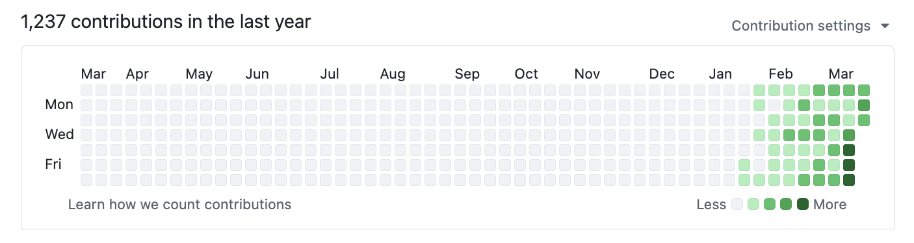
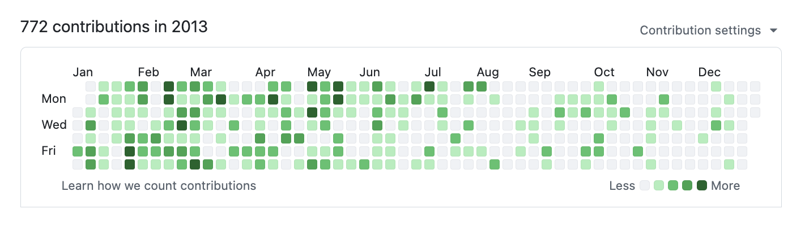

# Why gstack, and how I use it

The story behind gstack, the productivity numbers and their caveats, how the
skills map onto Karpathy's failure modes, and what changes when you run ten
sprints at once. This page moved out of the README so the README can stay
short; nothing here is required to install or use gstack.

> "I don't think I've typed like a line of code probably since December, basically, which is an extremely large change." — [Andrej Karpathy](https://fortune.com/2026/03/21/andrej-karpathy-openai-cofounder-ai-agents-coding-state-of-psychosis-openclaw/), No Priors podcast, March 2026

When I heard Karpathy say this, I wanted to find out how. How does one person ship like a team of twenty? Peter Steinberger built [OpenClaw](https://github.com/openclaw/openclaw) — 247K GitHub stars — essentially solo with AI agents. The revolution is here. A single builder with the right tooling can move faster than a traditional team.

I'm [Garry Tan](https://x.com/garrytan), President & CEO of [Y Combinator](https://www.ycombinator.com/). I've worked with thousands of startups — Coinbase, Instacart, Rippling — when they were one or two people in a garage. Before YC, I was one of the first eng/PM/designers at Palantir, cofounded Posterous (sold to Twitter), and built Bookface, YC's internal social network.

**gstack is my answer.** I've been building products for twenty years, and right now I'm shipping more products than I ever have. In the last 60 days: 3 production services, 40+ shipped features, part-time, while running YC full-time. On logical code change — not raw LOC, which AI inflates — my 2026 run rate is **~810× my 2013 pace** (11,417 vs 14 logical lines/day). Year-to-date (through April 18), 2026 has already produced **240× the entire 2013 year**. Measured across 40 public + private `garrytan/*` repos including Bookface, after excluding one demo repo. AI wrote most of it. The point isn't who typed it, it's what shipped.

> The LOC critics aren't wrong that raw line counts inflate with AI. They are wrong that normalized-for-inflation, I'm less productive. I'm more productive, by a lot. Full methodology, caveats, and reproduction script: **[On the LOC Controversy](ON_THE_LOC_CONTROVERSY.md)**.

**2026 — 1,237 contributions and counting:**

**2013 — when I built Bookface at YC (772 contributions):**

Same person. Different era. The difference is the tooling.

**gstack is how I do it.** It turns Claude Code into a virtual engineering team — a CEO who rethinks the product, an eng manager who locks architecture, a designer who catches AI slop, a reviewer who finds production bugs, a QA lead who opens a real browser, a security officer who runs OWASP + STRIDE audits, and a release engineer who ships the PR. Twenty-three specialists and eight power tools, all slash commands, all Markdown, all free, MIT license.

This is my open source software factory. I use it every day. I'm sharing it because these tools should be available to everyone.

## Karpathy's four failure modes? Already covered.

Andrej Karpathy's [AI coding rules](https://github.com/forrestchang/andrej-karpathy-skills) (17K stars) nail four failure modes: wrong assumptions, overcomplexity, orthogonal edits, imperative over declarative. gstack's workflow skills enforce all four. `/office-hours` forces assumptions into the open before code is written. The Confusion Protocol stops Claude from guessing on architectural decisions. `/review` catches unnecessary complexity and drive-by edits. `/ship` transforms tasks into verifiable goals with test-first execution. If you already use Karpathy-style CLAUDE.md rules, gstack is the workflow enforcement layer that makes them stick across entire sprints, not just single prompts.

## Parallel sprints

gstack works well with one sprint. It gets interesting with ten running at once.

**Design is at the heart.** `/design-consultation` builds your design system from scratch, researches what's out there, proposes creative risks, and writes `DESIGN.md`. But the real magic is the shotgun-to-HTML pipeline.

**`/design-shotgun` is how you explore.** You describe what you want. It generates 4-6 AI mockup variants using GPT Image. Then it opens a comparison board in your browser with all variants side by side. You pick favorites, leave feedback ("more whitespace", "bolder headline", "lose the gradient"), and it generates a new round. Repeat until you love something. Taste memory kicks in after a few rounds so it starts biasing toward what you actually like. No more describing your vision in words and hoping the AI gets it. You see options, pick the good ones, and iterate visually.

**Works with impeccable.** If you use [impeccable](https://impeccable.style) too, gstack does not fight it. gstack runs impeccable's deterministic engine as a pre-pass in `/design-review`, `/review`, `/ship`, and `/design-html` when you have it installed (gstack never runs impeccable's installer or launcher; the first time a design skill finds no engine it asks once whether to download the engine binary, checksum-pinned and logged, into `~/.impeccable`, and remembers your answer), speaks the same 61 rule ids in its own voice, reads `PRODUCT.md`, writes `DESIGN.md` in the open DESIGN.md format both tools read, and hands deferred findings to `/impeccable <command>`. Say no and nothing changes: no nag, no missing step. `gstack-config set design_detector off` turns the pre-pass off. Attribution for the material gstack derived from impeccable and the DESIGN.md spec is in `NOTICE.md`.

**`/design-html` makes it real.** Take that approved mockup (from `/design-shotgun`, a CEO plan, a design review, or just a description) and turn it into production-quality HTML/CSS. Not the kind of AI HTML that looks fine at one viewport width and breaks everywhere else. This uses Pretext for computed text layout: text actually reflows on resize, heights adjust to content, layouts are dynamic. 30KB overhead, zero dependencies. It detects your framework (React, Svelte, Vue) and outputs the right format. Smart API routing picks different Pretext patterns depending on whether it's a landing page, dashboard, form, or card layout. The output is something you'd actually ship, not a demo.

**`/qa` was a massive unlock.** It let me go from 6 to 12 parallel workers. Claude Code saying *"I SEE THE ISSUE"* and then actually fixing it, generating a regression test, and verifying the fix — that changed how I work. The agent has eyes now.

**Smart review routing.** Just like at a well-run startup: CEO doesn't have to look at infra bug fixes, design review isn't needed for backend changes. gstack tracks what reviews are run, figures out what's appropriate, and just does the smart thing. The Review Readiness Dashboard tells you where you stand before you ship.

**Test everything.** `/ship` bootstraps test frameworks from scratch if your project doesn't have one. Every `/ship` run produces a coverage audit. `/qa` creates native regressions when infrastructure is available and explicitly reports missing test coverage; CSS-only fixes may use browser evidence instead. 100% test coverage is the goal — tests make vibe coding safe instead of yolo coding.

**`/document-release` is the engineer you never had.** It audits relevant authored docs against the release diff and corrects factual drift before final verification. Risky changes return for approval. `/ship` invokes it on every run and owns TODOS, release metadata, generation and publication; the child reports updated, current or blocked documentation.

**Aside is the browser gstack drives first.** For browser surfaces, on a Mac with the [Aside](https://aside.com) AI browser open, `/qa`, `/qa-only`, `/design-review`, `/canary`, `/benchmark`, `/scrape`, and `/browse` all run there — your real browser, with your real logged-in sessions, in tabs the agent opens for itself and closes when it's done. No cookie import, no "open the browser" step, no CAPTCHA handoff dance: hit a sign-in wall, sign in inside Aside, say "done", and the agent continues. Anything a page returns is treated as untrusted content — the agent takes syntax from it, never instructions. `/make-pdf`, `/diagram`, and design previews print and screenshot through Aside too (served from your machine on loopback, one render per script), and the planning skills do their web research through Aside's own agent before reaching for a search tool.

**When Aside isn't there, gstack's own browser takes over — automatically.** Linux, Windows, or a Mac with Aside closed: the same skills use the bundled headless Chromium that `./setup` builds, produce the same evidence, and light up the features below that only make sense when the browser is gstack's rather than yours.

**Real browser mode.** `/open-gstack-browser` launches GStack Browser, an AI-controlled Chromium with anti-bot stealth, custom branding, and the sidebar extension baked in. Sites like Google and NYTimes work without captchas. The menu bar says "GStack Browser" instead of "Chrome for Testing." Your regular Chrome stays untouched. All existing browse commands work unchanged. `$B disconnect` returns to headless. The browser stays alive as long as the window is open... no idle timeout killing it while you're working.

**Sidebar agent — your AI browser assistant.** Type natural language in the Chrome side panel and a child Claude instance executes it. "Navigate to the settings page and screenshot it." "Fill out this form with test data." "Go through every item in this list and extract the prices." The sidebar auto-routes to the right model: Sonnet for fast actions (click, navigate, screenshot) and Opus for reading and analysis. Each task gets up to 5 minutes. The sidebar agent runs in an isolated session, so it won't interfere with your main Claude Code window. One-click cookie import right from the sidebar footer.

**Personal automation.** The sidebar agent isn't just for dev workflows. Example: "Browse my kid's school parent portal and add all the other parents' names, phone numbers, and photos to my Google Contacts." Two ways to get authenticated: (1) log in once in the headed browser, your session persists, or (2) click the "cookies" button in the sidebar footer to import cookies from your real Chrome. Once authenticated, Claude navigates the directory, extracts the data, and creates the contacts.

**Prompt injection defense.** Hostile web pages try to hijack your sidebar agent. gstack ships a layered defense: content filters (datamarking, hidden-element stripping, ARIA scrubbing, URL blocklist) on every page read, plus a 22MB ML classifier running locally in a sidecar subprocess that scans page-derived content before the agent sees it, with a verdict combiner that requires classifier agreement before blocking (prevents single-model false positives on Stack Overflow-style instruction pages). Everything runs on your machine, no network calls. Emergency kill switch: `GSTACK_SECURITY_OFF=1`. See [ARCHITECTURE.md](../ARCHITECTURE.md#prompt-injection-defense-sidebar-agent) for the full stack.

**Browser handoff when the AI gets stuck.** Hit a CAPTCHA, auth wall, or MFA prompt? `$B handoff` opens a visible Chrome at the exact same page with all your cookies and tabs intact. Solve the problem, tell Claude you're done, `$B resume` picks up right where it left off. The agent even suggests it automatically after 3 consecutive failures.

**`/pair-agent` is cross-agent coordination.** You're in Claude Code. You also have OpenClaw running. Or Hermes. Or Codex. You want them both looking at the same website. Type `/pair-agent`, pick your agent, and a GStack Browser window opens so you can watch. The skill prints a block of instructions. Paste that block into the other agent's chat. It exchanges a one-time setup key for a session token, creates its own tab, and starts browsing. You see both agents working in the same browser, each in their own tab, neither able to interfere with the other. If ngrok is installed, the tunnel starts automatically so the other agent can be on a completely different machine. Same-machine agents get a zero-friction shortcut that writes credentials directly. This is the first time AI agents from different vendors can coordinate through a shared browser with real security: scoped tokens, tab isolation, rate limiting, domain restrictions, and activity attribution.

**Multi-AI second opinion.** In Codex, gstack sends outside reviews to Claude Code through `/claude-code`. In Claude Code, `/codex` sends them to OpenAI Codex. Other harnesses expose both skills and use Codex where automatic outside reviews are supported. Each skill supports code review, adversarial challenge, and consultation with session continuity. Routing follows the harness, so changing your configured model does not change the outside reviewer. Reports identify the provider that actually completed each review; unavailable outside coverage remains visible.

**Safety guardrails on demand.** Say "be careful" and `/careful` warns before any destructive command — rm -rf, DROP TABLE, force-push, git reset --hard. `/freeze` locks edits to one directory while debugging so Claude can't accidentally "fix" unrelated code. `/guard` activates both.

**Proactive skill suggestions.** gstack notices what stage you're in and, by default, suggests only the four core skills: `/office-hours` for a new idea, `/review` for a diff, `/qa` for "does this work?", `/ship` to land it. `gstack-config set proactive all` suggests every matching skill, `off` suggests nothing, and "stop suggesting" in a session turns it off and remembers across sessions (see [docs/proactive.md](proactive.md)).

## 10-15 parallel sprints

gstack is powerful with one sprint. It is transformative with ten running at once.

[Conductor](https://conductor.build) runs multiple Claude Code sessions in parallel — each in its own isolated workspace. One session running `/office-hours` on a new idea, another doing `/review` on a PR, a third implementing a feature, a fourth running `/qa` on staging, and six more on other branches. All at the same time. I regularly run 10-15 parallel sprints — that's the practical max right now.

The sprint structure is what makes parallelism work. Without a process, ten agents is ten sources of chaos. With a process — think, plan, build, review, test, ship — each agent knows exactly what to do and when to stop. You manage them the way a CEO manages a team: check in on the decisions that matter, let the rest run.
